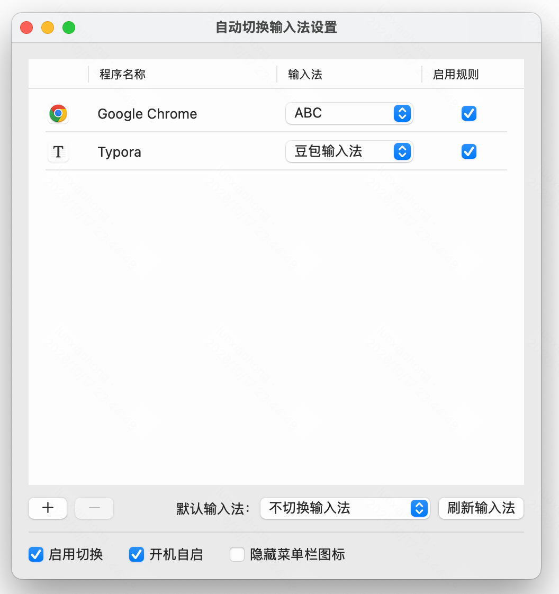

# InputPilot · 自动切换输入法

一个简单的 macOS 菜单栏工具，为不同应用指定输入法，切换应用时自动切换。比如在 Chrome 中使用英文，在 Typora 中使用中文，减少来回手动切换。



## 功能

- 按应用设置输入法，支持单独启用或停用规则。
- 为没有规则的应用指定默认输入法，也可以保持当前输入法不变。
- 支持一键暂停、开机自启和隐藏菜单栏图标。
- 手动切换输入法后不会立即改回，再次进入应用时才重新应用规则。
- 原生 Swift + SwiftUI 实现，无第三方依赖，不监听按键、不联网，配置保存在本机。

## 下载安装

下载 `InputPilot.dmg`，双击打开后，将「自动切换输入法.app」拖到镜像内的 `Applications` 文件夹快捷方式，然后从「应用程序」打开。安装完成后可以推出磁盘镜像。

当前安装包适用于 **Apple Silicon Mac，macOS 13 或更新版本**。

> 当前版本采用本地临时签名，尚未经过 Apple Developer ID 签名和公证，首次打开可能被系统拦截。请确认来源可信，不要关闭系统安全保护。

## 使用

1. 点击菜单栏图标，选择「显示主界面」。
2. 点击「＋」添加应用，在对应行选择输入法，设置自动保存。
3. 勾选「启用切换」，切换到目标应用即可生效。

可按需设置「默认输入法」和「开机自启」。使用前请暂停其他自动切换输入法工具，避免相互干扰。

## 从源码运行

需要 Xcode 和 Swift 6 工具链，在项目目录执行：

```bash
bash scripts/run.sh
```

运行测试或仅打包：

```bash
xcrun swift test
bash scripts/run.sh --build-only
```

应用生成在 dist/自动切换输入法.app。重新打包前，请先退出正在运行的应用。

生成可拖拽安装的 DMG（包含应用和 Applications 快捷方式，不启动应用）：

```bash
bash scripts/run.sh --dmg
```

安装包生成在 `dist/InputPilot.dmg`，打包脚本会校验应用签名和磁盘镜像。重复执行会替换该安装包。DMG 仍采用上述临时签名，不包含 Developer ID 签名或 Apple 公证。
